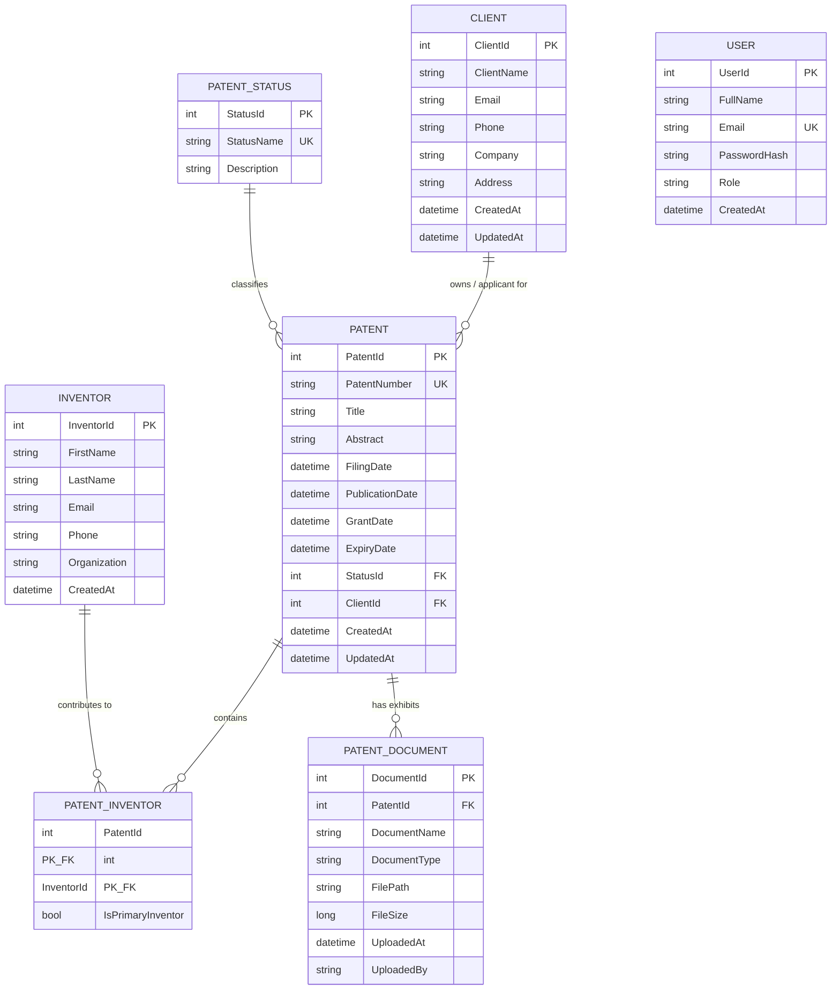

# IPVault — Intellectual Property & Patent Management System

> **"Manage, Track and Protect Intellectual Property."**

IPVault is a full-stack enterprise web application built with **ASP.NET Core Web API (.NET 8 LTS)**, **Entity Framework Core**, **SQL Server / SQLite**, and **Angular 19 (TypeScript)**. It helps organizations, patent law firms, and research departments manage patent disclosures, inventors, client assignees, critical prosecution deadlines, and legal document exhibits.

---

## 1. Features

- **JWT Authentication & RBAC:** Secure token-based authentication with role-based permissions (**Admin**, **Attorney**, and **Staff**).
- **Executive IP Dashboard:** Live metrics for total patents, granted patents, pending reviews, expired records, and client counts, along with interactive prosecution status progress and statutory deadline watch tables.
- **Patent Portfolio Management:**
  - Full CRUD operations with unique patent numbering constraints.
  - Server-side search across patent numbers, titles, and abstracts.
  - Multi-criteria filtering by status, applicant client, and filing year.
  - Server-side pagination.
- **Patent-Inventor Association:** Many-to-many junction relationship supporting primary inventor designation and co-inventors.
- **Client Management:** Applicant directory tracking corporate entities, registered offices, contact info, and total patent count with foreign key delete protection.
- **Inventor Directory:** Profiles of research scientists, affiliation labs, and patent contributions.
- **Document Management:** Upload, download, and track metadata for patent exhibits (Provisional/Complete Specifications, Drawings, Letters Patent Certificates).
- **Global Error Handling Middleware:** Uniform API responses (`ApiResponse<T>`) and exception handling with no exposed stack traces.
- **Swagger / OpenAPI:** Interactive API documentation with built-in JWT Bearer authorization support.

---

## 2. Technology Stack

### Backend
- **Framework:** .NET 8 LTS (C# 12)
- **API Framework:** ASP.NET Core Web API
- **ORM:** Entity Framework Core 8.0 (Code-First with Fluent API)
- **Database Engine:** Microsoft SQL Server / SQLite (configurable via `appsettings.json`)
- **Security & Tokens:** `System.IdentityModel.Tokens.Jwt`, `Microsoft.AspNetCore.Authentication.JwtBearer`, `BCrypt.Net-Next`
- **Documentation:** Swashbuckle / OpenAPI
- **Testing:** xUnit, Moq, EF Core In-Memory

### Frontend
- **Framework:** Angular 19
- **Language:** TypeScript 5.7+
- **Architecture:** Standalone Components, Angular Signals, Reactive Forms
- **HTTP & Auth:** Angular `HttpClient`, Functional `HttpInterceptorFn`, Route Guards (`authGuard`, `roleGuard`)
- **Styling:** Vanilla CSS design system with responsive layouts and custom status tokens

---

## 3. Architecture & Data Flow

```text
┌─────────────────────────────────────────────────────────────┐
│                      Angular Frontend                       │
│    (Signals Reactive State, Reactive Forms, Route Guards)   │
└──────────────────────────────┬──────────────────────────────┘
                               │ HTTP Requests (Bearer JWT)
                               ▼
┌─────────────────────────────────────────────────────────────┐
│                  ASP.NET Core Web API 8.0                   │
│                                                             │
│  ├── ExceptionMiddleware (Standardized Error Responses)     │
│  ├── Authentication / JWT Validation Middleware             │
│  ├── Controllers (Thin Endpoints, DTO mapping)              │
│  ├── Service Layer (Business Rules & Domain Validations)    │
│  ├── Repository Layer (Data Access Abstraction)             │
│  └── Entity Framework Core (LINQ Queries & Fluent Mapping)  │
└──────────────────────────────┬──────────────────────────────┘
                               │
                               ▼
┌─────────────────────────────────────────────────────────────┐
│                 Relational Database (SQL)                   │
└─────────────────────────────────────────────────────────────┘
```

---

## 4. Database ER Diagram



---

## 5. Database Normalization

- **1NF (Atomic Data):** Rather than storing multiple inventors in a single column (`"Rajesh, Sunita"`), inventors are stored in a distinct `Inventors` table and linked via the `PatentInventors` junction table.
- **2NF (No Partial Key Dependencies):** In the composite-key table `PatentInventors` (`PatentId`, `InventorId`), the attribute `IsPrimaryInventor` depends on the combination of both keys.
- **3NF (No Transitive Dependencies):** Status names and descriptions are separated into `PatentStatuses` instead of repeating strings in every patent record.

---

## 6. REST API Endpoints

### Authentication
| Method | Endpoint | Access | Description |
| :--- | :--- | :--- | :--- |
| `POST` | `/api/auth/login` | Anonymous | Authenticates credentials and returns JWT token |
| `POST` | `/api/auth/register` | Anonymous | Registers a new user account |
| `GET` | `/api/auth/me` | Authenticated | Returns current authenticated user profile |

### Patents
| Method | Endpoint | Access | Description |
| :--- | :--- | :--- | :--- |
| `GET` | `/api/patents` | Authenticated | Returns paginated list of patents (supports `search`, `status`, `clientId`, `year`, `page`, `pageSize`) |
| `GET` | `/api/patents/{id}` | Authenticated | Returns detailed patent record with inventors and documents |
| `POST` | `/api/patents` | Admin, Attorney | Files and registers a new patent |
| `PUT` | `/api/patents/{id}` | Admin, Attorney | Updates existing patent details |
| `DELETE` | `/api/patents/{id}` | Admin Only | Deletes a patent record |
| `GET` | `/api/patents/{id}/inventors` | Authenticated | Gets assigned inventors for a patent |
| `POST` | `/api/patents/{id}/inventors` | Admin, Attorney | Assigns an inventor to a patent |
| `DELETE` | `/api/patents/{id}/inventors/{invId}` | Admin, Attorney | Removes an inventor from a patent |
| `GET` | `/api/patents/{id}/documents` | Authenticated | Lists uploaded document exhibits |
| `POST` | `/api/patents/{id}/documents` | Admin, Attorney | Uploads document file (`multipart/form-data`) |

### Clients & Inventors
| Method | Endpoint | Access | Description |
| :--- | :--- | :--- | :--- |
| `GET` | `/api/clients` | Authenticated | Search & retrieve client organizations |
| `POST` | `/api/clients` | Admin, Attorney | Creates a new client |
| `PUT` | `/api/clients/{id}` | Admin, Attorney | Updates client details |
| `DELETE` | `/api/clients/{id}` | Admin Only | Deletes client (prevented if client has active patents) |
| `GET` | `/api/inventors` | Authenticated | Search & retrieve registered inventors |
| `POST` | `/api/inventors` | Admin, Attorney | Registers a new inventor |
| `PUT` | `/api/inventors/{id}` | Admin, Attorney | Updates inventor profile |
| `DELETE` | `/api/inventors/{id}` | Admin Only | Deletes inventor record |

### Dashboard & Statuses
| Method | Endpoint | Access | Description |
| :--- | :--- | :--- | :--- |
| `GET` | `/api/dashboard/summary` | Authenticated | Returns aggregated KPI statistics, charts data, and upcoming expiry alerts |
| `GET` | `/api/patentstatuses` | Authenticated | Lists all patent lifecycle statuses |

---

## 7. Installation & Quick Start

### Prerequisites
- [.NET 8 SDK](https://dotnet.microsoft.com/download/dotnet/8.0)
- [Node.js (v18+)](https://nodejs.org/) and npm

### 1. Backend Setup & Startup
```bash
# Navigate to API project
cd backend/IPVault.API

# Run EF Core database migration (or automatic startup seeding)
dotnet run --urls "http://localhost:5000"
```
The backend API and Swagger UI will be live at:
- **Swagger Documentation:** [http://localhost:5000](http://localhost:5000)

### 2. Frontend Setup & Startup
```bash
# Navigate to Angular project
cd frontend/ipvault

# Install dependencies (if not already installed)
npm install

# Start development server
npx ng serve --port 4200
```
Open [http://localhost:4200](http://localhost:4200) in your browser.

---

## 8. Demo Credentials

The database automatically seeds 3 accounts with pre-configured roles:

| Role | Email | Password | Permissions |
| :--- | :--- | :--- | :--- |
| **Admin** | `admin@ipvault.com` | `Admin@123` | Full access (Create, Read, Update, Delete across all entities) |
| **Attorney** | `attorney@ipvault.com` | `Attorney@123` | Create & edit patents, manage inventors, upload documents |
| **Staff** | `staff@ipvault.com` | `Staff@123` | Read-only access to view patents, clients, and inventors |

> **Tip:** The login page includes 1-click **Demo Login** buttons to switch between roles during interviews.

---

## 9. Running Unit Tests

The backend includes comprehensive unit tests using **xUnit** and **Moq**:
```bash
dotnet test
```
**Test Coverage Includes:**
- `AuthServiceTests`: Valid/invalid credentials, duplicate registration prevention, JWT generation.
- `ClientServiceTests`: Client creation, delete protection rule when patents exist.
- `PatentServiceTests`: Duplicate patent number checks, expiry before filing date validation, minimum 1 inventor requirement, Admin-only deletion enforcement, and search filtering.
- `PatentValidationTests`: `IValidatableObject` model validation rules.

---

## 10. Key Files for Interview Review

- **Entities & Relations:** [ApplicationDbContext.cs](file:///c:/Users/Admin/Desktop/codes/ipvault/backend/IPVault.API/Data/ApplicationDbContext.cs)
- **Business Logic & Rules:** [PatentService.cs](file:///c:/Users/Admin/Desktop/codes/ipvault/backend/IPVault.API/Services/PatentService.cs)
- **Global Error Handling:** [ExceptionMiddleware.cs](file:///c:/Users/Admin/Desktop/codes/ipvault/backend/IPVault.API/Middleware/ExceptionMiddleware.cs)
- **Auth Interceptor:** [auth.interceptor.ts](file:///c:/Users/Admin/Desktop/codes/ipvault/frontend/ipvault/src/app/core/interceptors/auth.interceptor.ts)
- **Auth Service & Signals:** [auth.service.ts](file:///c:/Users/Admin/Desktop/codes/ipvault/frontend/ipvault/src/app/core/services/auth.service.ts)
- **Dashboard Component:** [dashboard.component.ts](file:///c:/Users/Admin/Desktop/codes/ipvault/frontend/ipvault/src/app/features/dashboard/dashboard.component.ts)

---

## 11. Interview Preparation Guide

### ASP.NET Core & C#
1. **Why use a Layered Architecture instead of writing logic in Controllers?**
   - *Answer:* Keeping controllers thin isolates HTTP routing and response formatting from business logic and data access. This ensures code is modular, reusable, easily testable with unit tests (via mock interfaces), and conforms to the Single Responsibility Principle (SRP).

2. **How does Dependency Injection (DI) work in ASP.NET Core?**
   - *Answer:* Service lifecycles are registered in `Program.cs` as `Transient` (new instance every request), `Scoped` (one instance per HTTP request lifecycle, standard for DbContext and repositories), or `Singleton` (single instance across the entire application runtime).

3. **How is password security handled?**
   - *Answer:* Passwords are never stored in plain text. We use `BCrypt.Net` with salted hashing. Verification compares the salted hash during login.

### Entity Framework Core & SQL
1. **How is the many-to-many relationship between Patents and Inventors configured?**
   - *Answer:* Via the junction entity `PatentInventor` with a composite primary key (`PatentId` + `InventorId`) configured in EF Core Fluent API (`OnModelCreating`), allowing additional junction metadata like `IsPrimaryInventor`.

2. **How does LINQ handle server-side filtering and pagination?**
   - *Answer:* Using `IQueryable<T>`, EF Core builds an expression tree and executes SQL with `WHERE`, `ORDER BY`, `OFFSET ... ROWS FETCH NEXT ... ROWS ONLY` (via `.Skip()` and `.Take()`), retrieving only the requested page of records from the database.

### Angular
1. **What are the advantages of Angular Signals over traditional state management?**
   - *Answer:* Signals provide fine-grained reactivity. When a signal value changes, Angular knows precisely which template nodes depend on it and updates the DOM efficiently without full component tree dirty checks.

2. **How does the HTTP Interceptor protect API calls?**
   - *Answer:* The functional `authInterceptor` intercepts every outgoing HTTP request, clones it, and attaches the JWT Bearer token in the `Authorization` header. It also catches `401 Unauthorized` responses to clear invalid sessions and redirect to the login page.
# Ipvault

