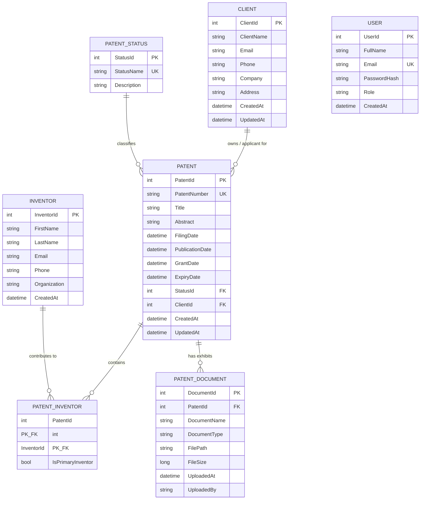

# IPVault — Database Design & Normalization Guide

## Entity Relationship (ER) Overview

---

## Normalization Breakdown

### 1. First Normal Form (1NF)
- **Rule:** Each column contains atomic (indivisible) values, and each record is unique.
- **Implementation:** Rather than storing a comma-separated list of inventors (`"John, Jane, Rahul"`) or repeating columns (`Inventor1`, `Inventor2`) in `Patents`, each inventor is stored as an individual row in `Inventors` and linked via the `PatentInventors` junction table.

### 2. Second Normal Form (2NF)
- **Rule:** The table is in 1NF and all non-key attributes are fully functionally dependent on the entire primary key.
- **Implementation:** In the composite-key table `PatentInventors` (`PatentId` + `InventorId`), the attribute `IsPrimaryInventor` depends on the entire combination of patent and inventor, rather than either entity alone.

### 3. Third Normal Form (3NF)
- **Rule:** The table is in 2NF and has no transitive dependencies (no non-key attribute depends on another non-key attribute).
- **Implementation:** Patent statuses are normalized into `PatentStatuses` (`StatusId`, `StatusName`, `Description`). The `Patents` table stores only `StatusId` (foreign key), preventing redundant repetition and anomalies when updating status descriptions.
